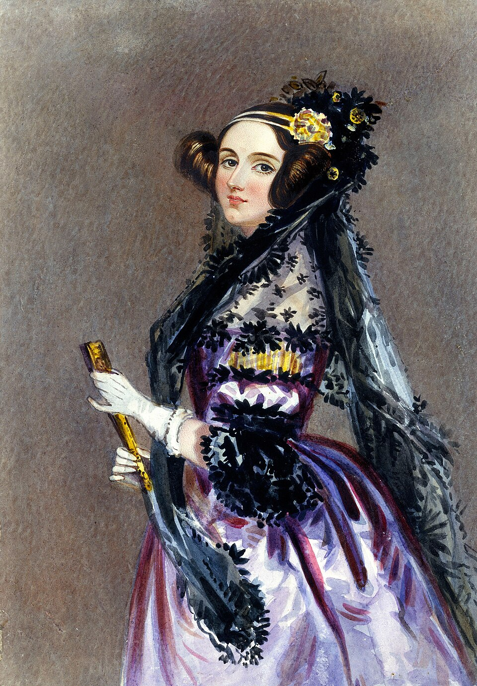
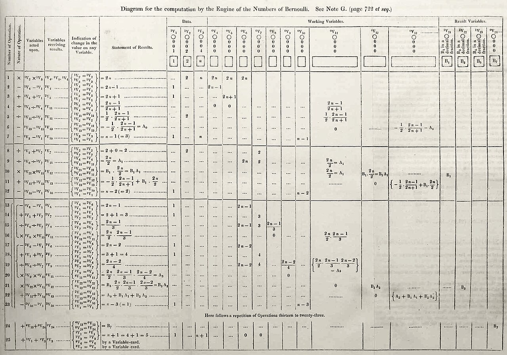

# Ada Lovelace and the First Program

## Ada Lovelace and the First Program

**Augusta Ada King, Countess of Lovelace** (1815–1852), daughter of the poet Lord Byron, was a gifted mathematician and Babbage's most insightful collaborator. She is widely regarded as the **first computer programmer**.

_Ada Lovelace, in a watercolour portrait by Alfred Edward Chalon, c. 1840. Public domain._

### The translation and the Notes

In 1842 the Italian engineer Luigi Menabrea published a French account of a lecture Babbage had given on the Analytical Engine. Ada Lovelace translated it into English — and then, at Babbage's suggestion, added a series of **Notes** of her own that were roughly three times longer than the original article.

These Notes, published in 1843 and labelled A through G, contain some of the most far-sighted writing in the history of computing.

### Note G and the first algorithm

**Note G** contains a detailed, step-by-step method for the engine to compute the **Bernoulli numbers**. Because it is a complete sequence of operations designed to be carried out by the machine, it is often described as the **first published computer program**.

_Lovelace's diagram from Note G (1843). Each row is one operation of the engine, showing which variables in the Store are used and where the result is placed. Public domain._

### Beyond mere calculation

Lovelace grasped something Babbage himself under-emphasised: that a machine manipulating symbols could do far more than arithmetic. She speculated that, given the right rules, the engine might one day compose music or manipulate any symbols whatsoever — an astonishingly modern vision of general-purpose computing.


Lovelace also cautioned against overstating the machine's abilities, writing that the Analytical Engine "has no pretensions whatever to _originate_ anything" — it can only do what we know how to order it to perform. This observation is still quoted in debates about artificial intelligence today.

