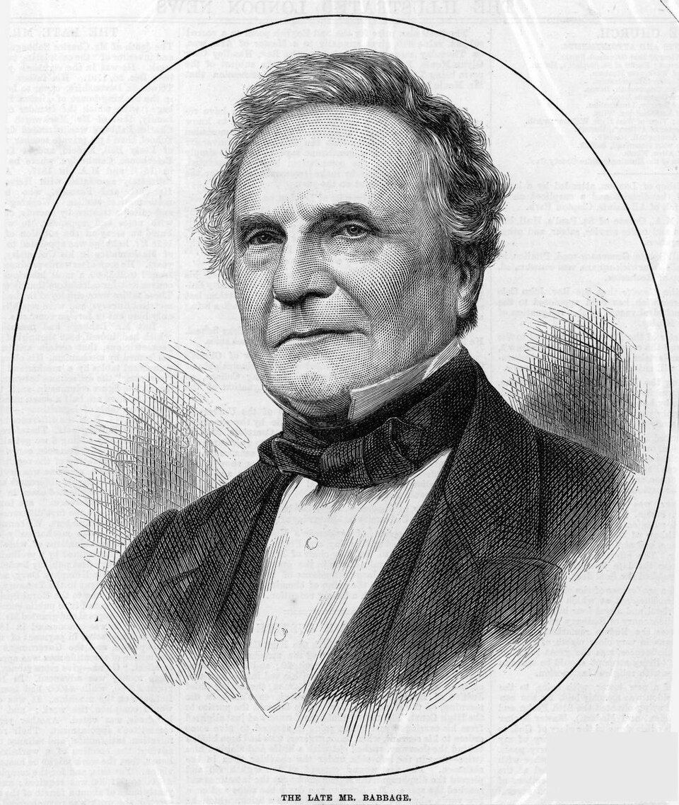

# Charles Babbage: The Man

## Charles Babbage: The Man

**Charles Babbage** (26 December 1791 – 18 October 1871) was an English polymath: a mathematician, philosopher, inventor, and mechanical engineer. He is best remembered as the originator of the concept of a programmable computer.

_Charles Babbage, from an 1871 obituary portrait based on a photograph taken in 1860. The Illustrated London News, public domain._

### Early life and education

Babbage studied at Trinity College and later Peterhouse, Cambridge. Dissatisfied with the state of mathematics teaching in England, he co-founded the **Analytical Society** in 1812 with John Herschel and George Peacock, promoting continental methods of calculus over the Newtonian notation then dominant in Britain.

### A frustration with error

The motivation for Babbage's life work is often summarised by a story he told of poring over error-filled astronomical and mathematical tables with Herschel around 1821, exclaiming that he wished the calculations "could be executed by steam." Navigation, engineering, banking, and science all depended on printed tables that were computed and typeset by hand — and were riddled with mistakes.

### A wide-ranging mind

Beyond his engines, Babbage:

* Held the **Lucasian Professorship of Mathematics** at Cambridge (1828–1839), the chair once held by Isaac Newton.
* Contributed to cryptography, breaking the Vigenère autokey cipher.
* Helped found the Royal Astronomical Society and the Statistical Society of London.
* Wrote _On the Economy of Machinery and Manufactures_ (1832), an early work of operations research.
* Invented the _pilot_ (or cow-catcher) for locomotives and studied lighthouse signalling.


Babbage was also famously irritated by street musicians, campaigning publicly against them late in his life.

