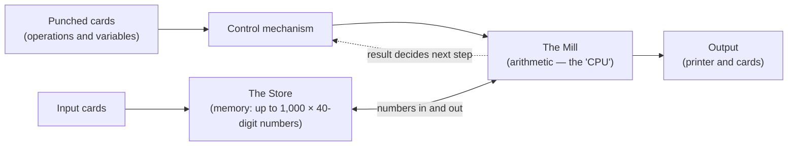

# The Analytical Engine

## The Analytical Engine

Where the Difference Engine could only tabulate polynomials, the **Analytical Engine**, designed from 1837 onward, was something entirely new: a **general-purpose, programmable computer**. It is Babbage's most profound contribution to the history of computing.

### A recognisably modern architecture

The Analytical Engine separated computation into components that map directly onto the parts of a modern computer:

* **The Store** — the memory, holding numbers (up to 1,000 numbers of 40 decimal digits in one design).
* **The Mill** — the processing unit, performing the four arithmetic operations. This is the equivalent of a modern CPU.
* **A control mechanism** driven by **punched cards**, adapted from the Jacquard loom that wove patterned fabric.
* **Input and output** via cards and a printer.

The dotted arrow is what made the design revolutionary: the result of a calculation in the Mill could change which cards the control mechanism read next.

### Programmability

Crucially, the engine supported ideas we now consider essential to computing:

* **Conditional branching** — the machine could take different actions depending on the results of a computation.
* **Loops** — sequences of operations could be repeated.
* **Separate program and data** — instructions on cards, numbers in the store.

This makes the Analytical Engine **Turing-complete** in principle, over a century before Alan Turing formalised the concept.


Because it was never built, the Analytical Engine had no fixed final form — Babbage refined its design continuously until his death in 1871. His son, Henry Prevost Babbage, later constructed a portion of the Mill.

