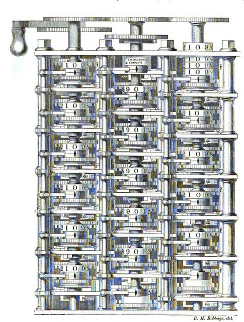

# The Difference Engine

## The Difference Engine

The **Difference Engine** was Babbage's first major design: a special-purpose mechanical calculator built to tabulate **polynomial functions**.

### The method of finite differences

Many useful mathematical functions — logarithms, trigonometric values, and more — can be closely approximated by polynomials. Polynomials have a remarkable property: their successive differences eventually become constant. This means a table of values can be generated using only **repeated addition**, avoiding multiplication and division entirely. A machine that could add and carry reliably could therefore compute entire tables automatically.

#### A worked example

Babbage liked to demonstrate his engine with the polynomial **f(x) = x² + x + 41**. Take the differences between neighbouring values, then the differences of those differences:

| x | f(x) | 1st difference | 2nd difference |
| - | ---- | -------------- | -------------- |
| 0 | 41   | 2              | 2              |
| 1 | 43   | 4              | 2              |
| 2 | 47   | 6              | 2              |
| 3 | 53   | 8              |                |
| 4 | 61   |                |                |

The second difference is always **2**. To find the next value, the engine simply adds upwards: 8 + 2 = 10 for the new first difference, then 61 + 10 = **71** for f(5). Every further row follows by addition alone — exactly the kind of work gears can do.

### Difference Engine No. 1

In 1822 Babbage proposed the engine to the Royal Society and secured government funding — one of the earliest instances of state investment in technology research. Work began in 1823 with the skilled engineer **Joseph Clement**.

The full design called for around **25,000 parts** and would have weighed several tonnes. In 1832 Babbage and Clement completed a working demonstration portion — about one-seventh of the machine — which still functions today and is one of the finest examples of precision engineering of its era.

_The completed portion of Difference Engine No. 1, from an 1853 woodcut after a drawing by Babbage's son Benjamin Herschel Babbage. Public domain._


The project collapsed around 1833 after a dispute with Clement over payment and ownership of the tools. The government eventually abandoned it in 1842, having spent roughly £17,000 — an enormous sum at the time.


### Difference Engine No. 2

Between 1847 and 1849, having learned from the Analytical Engine work, Babbage designed a far more elegant **Difference Engine No. 2**, achieving the same results with roughly a third of the parts. It was never built in his lifetime — but it would be, nearly 150 years later (see [Legacy and Reconstructions](legacy-and-reconstructions.md)).
