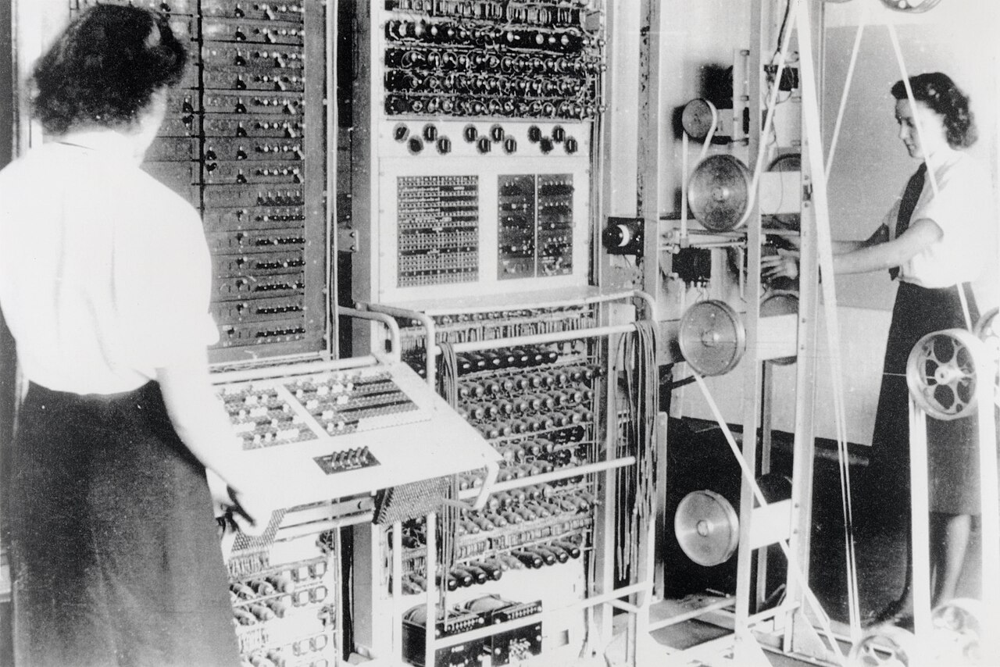

# Introduction

## Introduction

**Colossus** was the world's first large-scale, programmable, electronic, digital computer. It was built by British codebreakers between 1943 and 1945 to accelerate the breaking of the **Lorenz cipher** — the high-level teleprinter code used by the German High Command during the Second World War.

Designed by the Post Office engineer **Tommy Flowers**, Colossus used thousands of vacuum tubes to perform, in hours, statistical analysis that had previously taken weeks by hand. It entered service at **Bletchley Park** in early 1944, months before the D-Day landings, and the intelligence it helped produce is credited with shortening the war.

_A Colossus Mark 2 at Bletchley Park, operated by Wrens Dorothy Du Boisson (left) and Elsie Booker (right). UK Government photograph, public domain._


Colossus is often confused with the work on the Enigma machine. In fact the two were separate efforts: the electromechanical **Bombe** attacked Enigma, while the electronic **Colossus** attacked the far more complex Lorenz cipher.


### At a glance

|                   | Colossus                                               |
| ----------------- | ------------------------------------------------------ |
| Purpose           | Cryptanalysis of the Lorenz (Tunny) cipher             |
| Designer          | Tommy Flowers, Post Office Research Station            |
| First operational | Mark 1: February 1944 · Mark 2: June 1944              |
| Technology        | \~1,600 (Mk 1) to \~2,400 (Mk 2) vacuum tubes          |
| Number built      | 10 by the end of the war                               |
| Programmable      | Yes, via switches and plug panels (not stored-program) |
| Location          | Bletchley Park, England                                |

Use the navigation to explore the cipher it broke, the engineer who built it, how it worked, and its long-secret legacy.
