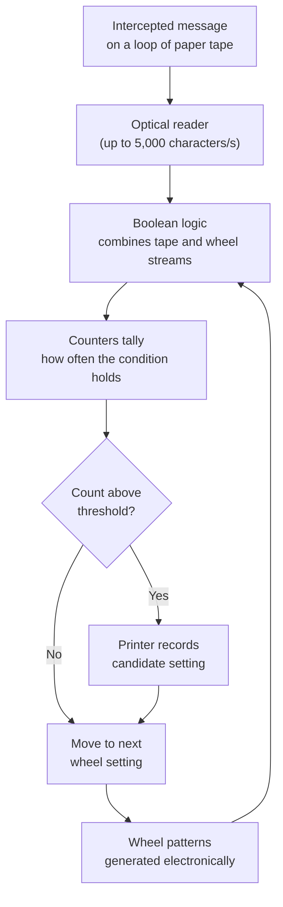

# How Colossus Worked

## How Colossus Worked

Colossus was designed to do one thing extremely well: run **statistical tests** on intercepted Tunny messages to find the most likely starting positions of the Lorenz cipher wheels.

### The method

* The encrypted message was read from a loop of **paper tape** by a fast optical reader, at up to **5,000 characters per second**.
* Internally, Colossus generated the patterns of the Lorenz wheels **electronically**, removing the need for a second, synchronised tape.
* For each candidate wheel setting, it performed a **Boolean and counting** operation across the whole message, tallying how often certain conditions held.
* When a count crossed a chosen threshold, the setting was flagged as a promising candidate — the printout guided the codebreakers to the correct key.

### Programmable, but not a modern computer

Colossus could be **reconfigured** for different statistical tests using banks of **switches and plugboards**, which is why it counts as programmable. However, it was not a general-purpose machine in the modern sense:

* It had **no stored program** — instructions were set physically, not held in memory.
* It was **special-purpose**, dedicated to cryptanalytic counting, and was **not Turing-complete**.


This is why historians are careful with the phrase "first computer." Colossus was the first _programmable, electronic, digital_ computer — but the first _stored-program_ computer was the later Manchester "Baby" (1948).


### Speed that changed the war

What had taken weeks of hand computation could now be done in hours. Decrypted Tunny messages gave the Allies direct insight into German strategic thinking, including confirmation that deception operations before **D-Day** had succeeded.
