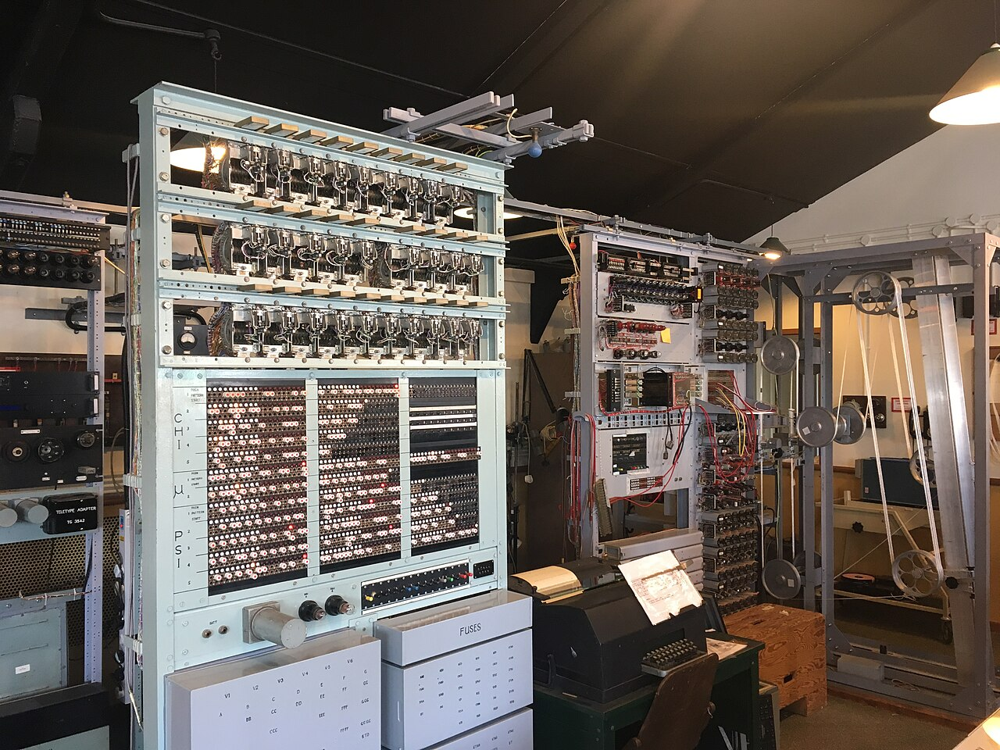

# Secrecy and Rediscovery

## Secrecy and Rediscovery

### Erased from history

After the war, Colossus remained one of Britain's most closely guarded secrets. On orders reportedly from Winston Churchill, **eight of the ten machines were dismantled** and their drawings destroyed. The remaining two were moved to GCHQ and used until the 1960s.

Because of this secrecy, the people who built and operated Colossus could tell no one — and for decades the credit for the first electronic computer went elsewhere, notably to the American **ENIAC** (1945). Tommy Flowers received little public recognition in his lifetime.


The existence of Colossus was not officially acknowledged until the **1970s**, and full technical details were not released until the **1990s and 2000s**. This is why it is missing from most early histories of computing.


### Rebuilding Colossus

Beginning in **1993**, engineer **Tony Sale** led an ambitious project to reconstruct a working Colossus Mark 2 from fragmentary evidence: a handful of surviving wartime photographs, engineers' recollections, and declassified documents.

* The rebuilt machine was substantially working by **1996** and completed in **2008**.
* It is on display at **The National Museum of Computing** at Bletchley Park, where visitors can see it in operation.

_The working Colossus reconstruction at The National Museum of Computing, Bletchley Park. Released under CC0 (public domain dedication) via Wikimedia Commons._

### Legacy

* Colossus proved that **large-scale electronics** could be made reliable, paving the way for the computer age.
* It demonstrated the power of **special-purpose electronic computation** years before general-purpose machines existed.
* The recognition of Flowers, Tutte, Newman, and their colleagues has grown steadily as the records have been declassified, securing Bletchley Park's place at the birth of computing.
