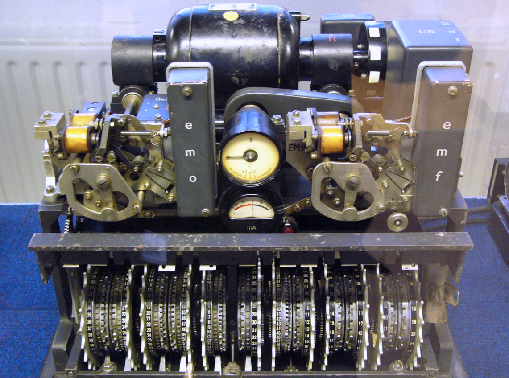
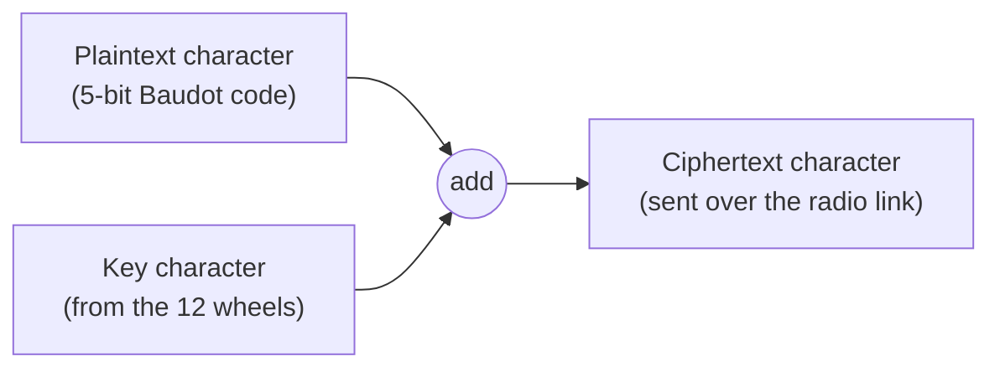

# The Lorenz Cipher

## The Lorenz Cipher

While the German Enigma machine is the most famous cipher of the Second World War, the most secret German communications — messages between Hitler and his senior generals — were protected by a different and far more sophisticated system: the **Lorenz SZ40/42** cipher machine.

### Tunny

British codebreakers had never seen the machine, so they gave it and its traffic the codename **Tunny**. Unlike Enigma, which was used by operators in the field, Lorenz was an online teleprinter cipher attached directly to teleprinter circuits, encrypting messages automatically as they were typed.

_A Lorenz SZ42 with its covers removed, on display at Bletchley Park. The row of twelve wheels generated the key stream. Photograph by Matt Crypto, public domain._

### How the cipher worked

Lorenz encrypted teleprinter signals (in the 5-bit **Baudot code**) by adding a pseudo-random stream of characters generated by **twelve rotating wheels**. Breaking a message meant reconstructing the starting positions and patterns of those wheels — an enormous combinatorial problem.

Because the addition works bit by bit, adding the **same key again** turns the ciphertext back into plaintext. The receiving machine, set to the same wheel positions, decrypted messages automatically — which is why recovering the wheel settings was everything.

### A gift from a German mistake

In August 1941 a German operator retransmitted a long message using the _same_ wheel settings after a request to repeat it — a catastrophic breach of procedure. From these two nearly-identical messages, the mathematician **John Tiltman** recovered the key stream, and the brilliant young mathematician **Bill Tutte** then deduced the entire logical structure of a machine he had never seen — one of the greatest feats of cryptanalysis in history.


Tutte's reconstruction meant the codebreakers understood _how_ Tunny worked. The remaining problem was speed: finding each message's wheel settings fast enough to be useful. That is the problem Colossus was built to solve.

